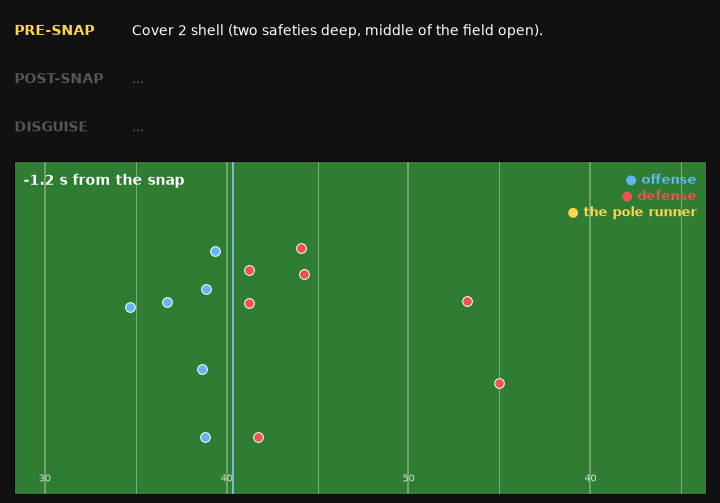

# NFL Coverage Analyzer

[](https://github.com/jasperwang183-ux/nfl-coverage-analyzer/actions/workflows/tests.yml)
[](LICENSE)

NFL defenses lie before the snap. They line up showing one coverage (say, two safeties deep)
and rotate into another the moment the ball moves, so the quarterback reads the wrong
picture. This project reads both sides of that lie: **what the defense showed before the
snap, what it actually ran after it, and the move that disguised one as the other**. It
learns from NFL player-tracking data, then runs the same models on game film through a
computer-vision pipeline.



*2023 Week 2, 49ers at Rams. Every dot is a player the vision pipeline found and tracked on
all-22 film, mapped onto the field (offense moving right; no footage is shown). The defense
shows two deep safeties; at the snap a linebacker (gold) sprints into the deep middle
between them, the "pole run" that turns a Cover 2 look into Tampa 2. The three lines are
the page's cards, word for word. Rendered with `scripts/render_demo.py`.*

## Results

All numbers are on a **frozen holdout** (2018 weeks 14-17 and 2023 weeks 14-18) that no
model or rule was tuned on, each scored once.

**Coverage classifier** (8 coverage classes, n = 8,234 holdout plays):

| model | top-1 | top-2 |
|---|---|---|
| majority class | 32.8% | |
| gradient boosting on snap features | 51.8% | 74.6% |
| sequence model, pre-snap head ("what are they showing?") | 59.2% | 80.7% |
| **sequence model, full-play head ("what did they run?")** | **86.5%** | **97.0%** |

The two heads disagree on 39.7% of plays, and when they do the full-play head is right
80% of the time. That gap is the disguise signal.

**Named disguise mechanisms** (rules fitted on weeks 1-13, each fires on a small slice of
plays and names what it saw):

| mechanism | what it sees | holdout |
|---|---|---|
| safety buzz | a deep safety drops down and wide in the first second | Cover 3 on 81.3% of 182 plays |
| front bluff | defenders show pressure at the line, then drop | 4 or fewer rushed on 80.4% of 51 plays (base rate 71.8%) |
| second-level rush | a linebacker or DB comes downhill fast | 5+ rushers on 77.2% of 167 plays (base rate 28.2%) |

**On real film** (2023 holdout plays clipped by hand and matched to their tracking labels):
the played middle-of-field call, both model heads and the disguise read are each right on
3 of 4 plays. Four plays is a sanity check, not a benchmark. More in
[docs/HANDOFF.md](docs/HANDOFF.md).

## How it works

```
                 ┌──────────────────────────────────────────────────────────┐
  mp4 / still ─► │ frame sampling ─► auto-calibration from the painted       │
                 │ markings (yard lines, hashes, sidelines, numbers)         │
                 │ ─► YOLO + ByteTrack ─► foot points through the homography │ ─► field-space (x, y)
                 │ (calibration chained frame to frame as the camera pans)   │     tracks at 10 Hz
                 └──────────────────────────────────────────────────────────┘
                                       │
  NGS tracking data (Big Data Bowl) ───┤   (same canonical schema;
   = the TRAINING data                 │    film is inference-time input)
                                       ▼
                 ┌──────────────────────────────────────────────────────────┐
                 │ Player filtering (film only): jersey colors, officials by │
                 │ stripes, sides voted with formation geometry, linemen     │
                 │ set aside, field-visibility guard (cropped ≠ absent)      │
                 └──────────────────────────────────────────────────────────┘
                                       ▼
          ┌────────────────────────────┴───────────────────────────────┐
          ▼                                                            ▼
 ┌────────────────────────────────┐              ┌────────────────────────────────────┐
 │ Shell reader (rules): deep     │              │ Sequence model (PyTorch): Cover    │
 │ count, middle open/closed,     │              │ 0/1/2/3/4/6, man vs. zone, with a  │
 │ corner technique, at the snap  │              │ pre-snap head and a full-play head │
 │ and again after it             │              │                                    │
 └────────────────────────────────┘              └────────────────────────────────────┘
          │                                                            │
          └────────────────────────────┬───────────────────────────────┘
                                       ▼
                 ┌───────────────────────────────────────────────────────────┐
                 │ Disguise: shell rotation (Spin / Split), named mechanisms │
                 │ (pole run, late post, corner roll-up, safety buzz), the   │
                 │ front and the rush (blitz / simulated pressure)           │
                 └───────────────────────────────────────────────────────────┘
                                       ▼
                 Three cards: pre-snap read, post-snap read, disguise,
                 each with the call, why (in yards), how sure, and what could flip it
```

**The key design choice: learn from tracking data, run on film.** The Big Data Bowl
datasets are not video. They are Next Gen Stats tracking data: every player's (x, y) at
10 Hz, with coverage labels. So the hard problem (recognizing coverage) is solved on clean,
labeled data first, and the vision pipeline's only job is to turn film into that same
field-coordinate format. Nothing trains on film. See
[docs/ARCHITECTURE.md](docs/ARCHITECTURE.md) for how each stage is computed.

## Design decisions worth reading

- **A holdout that stays frozen.** Weeks 14-18 are never used to tune anything. Every rule
  and model is scored on them once and never re-scored; the disguise rules had their pass
  marks written down before the run. Rules that fell short in tuning (a robber rule, a
  Cover 3 Cloud call) were dropped instead of shipped.
- **Measure before building.** Choices like where to measure "sideways" from (the ball, the
  quarterback, or the field's middle) were settled by a paired comparison on 22,137 tuning
  plays, not by intuition.
- **No hand-labeled training data.** The tracking labels say what coverage was played, which
  implies where the safeties ended up. That gives the shell reader a free accuracy check
  on thousands of plays.
- **Say "unsure" when nothing can check it.** Film can't confirm who rushed the passer, so
  the front and rush line is always marked unsure and the page takes a manual correction.

## Data

| Dataset | What it provides |
|---|---|
| [NFL Big Data Bowl 2021](https://www.kaggle.com/competitions/nfl-big-data-bowl-2021/data) | 2018-season tracking for every pass play, including 1 s of pre-snap frames; coverage labels joined from [nflverse participation data](https://github.com/nflverse/nflverse-data) (~17K labeled plays) |
| [NFL Big Data Bowl 2026](https://www.kaggle.com/competitions/nfl-big-data-bowl-2026-analytics/data) | 2023-season tracking (snap to pass release) with built-in coverage labels (~14K labeled plays) |

The data can't be redistributed, so it is not in this repo. See
[data/README.md](data/README.md) to download it with the Kaggle API.

## Run it

```bash
python -m venv .venv
.venv\Scripts\activate
pip install -r requirements.txt
pytest -m "not slow"                      # 263 tests on synthetic frames, no data needed
```

**The page.** `python scripts/serve.py`, then open http://127.0.0.1:8000. Upload an mp4 of
one play from an elevated (all-22 style) angle. The page finds the snap, the line of
scrimmage and the field's yard lines on its own, tracks the players (about a minute on a
GPU), draws the read on the playing video and shows the three cards. Correct / Wrong on
each card and a manual front / rush input log corrections for later review.

**From the command line.** `scripts/track_clip.py` reads a clip end to end,
`scripts/verify.py film` checks the film pipeline on a set of clips, and
`scripts/verify.py bdb` scores the models on tracking data. Each script's docstring has
its usage.

## Project structure

```
src/nfl_coverage/
├── data/        # load and standardize both Big Data Bowl seasons into one schema
├── features/    # pre-snap alignment and post-snap movement features
├── models/      # gradient-boosting baseline and the two-head sequence model
├── vision/      # detection, calibration, tracking, snap and formation inference
├── analysis/    # shell reader, disguise mechanisms, front and rush, the cards
└── web/         # FastAPI app and the one-page front end
scripts/         # training, film ingest, verification, the demo GIF
tests/           # unit tests on tiny synthetic tracking frames
docs/            # architecture, data notes, disguise methodology, development log
```

## Limits

- **Camera angle.** The film pipeline needs an elevated, all-22 style view. Broadcast
  angles crop the deep safeties out of frame.
- **Film evaluation is small.** Four labeled holdout plays so far.
- **Crowded lines.** The detector merges offensive and defensive linemen into a few boxes,
  so the front count is rough.
- **Team tendencies** (how often each defense plays what it shows) are built from 2018 and
  2023 staffs and left off the page, since they say little about a clip from another season.

## Future work

- Fine-tune the detector on line play so fronts and rushers can be counted.
- A live-feed overlay: the same pipeline on a video stream, a few seconds behind.
- Grow the labeled film test set by matching more clips to tracking plays.

Built with Python, pandas, PyTorch, scikit-learn, Ultralytics YOLO, OpenCV and FastAPI.
